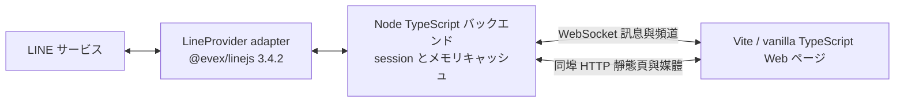
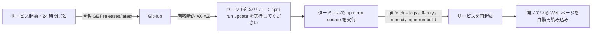

[繁體中文](README.md) ｜ [English](README.en.md) ｜ **日本語**

# LINE.js

ローカルで動作する TypeScript 製 LINE Web クライアントです。バージョンを固定した [@evex/linejs v3.4.2](https://github.com/evex-dev/linejs/tree/v3.4.2) で LINE に接続し、WebSocket でチャンネルとメッセージを同期し、同じポートの HTTP で Web ページを配信します。

> 開発状況：QR ログイン／ログアウト、session の再利用、チャンネル一覧（友だちとチャットのタブ、プロフィール画像）、リアルタイム・履歴メッセージ、テキスト／画像／動画／スタンプの送信（画像や動画の貼り付け、所有済みスタンプパックからの選択に対応）、受信した画像／GIF／動画／音声の埋め込み表示、相手の既読、既読通知と未読数、オープンチャットの管理者バッジ、メッセージ内のリンク、システムメッセージ（例：「XX 新增 OO 至群組」（XX が OO をグループに追加））、切断時の全画面オーバーレイ、モバイル版ハンバーガーメニュー、ボット API（`/api/ws`）、ターミナルインターフェース（CLI）、バージョン更新通知が利用できます。サブアカウントで QR コードを読み取る Gate 1 の受け入れ確認は、まだ小語による確認待ちです。

## 確定した用途と対象範囲

全体の目標には、QR コードによるログイン／ログアウト、session の再利用、友だち／グループ／チャットルーム／オープンチャットの一覧、リアルタイムメッセージと編集イベント、履歴のページ取得、テキスト／画像／スタンプの送信、画像／GIF／動画／音声／スタンプの表示、ファイルのダウンロードが含まれます。オプションで、TypeSafe Jev による相手のテキストメッセージの詐欺確率分析も利用できます。公開環境へのデプロイ、複数アカウント、通話、パッケージ公開は提供しません。未提供の機能については Gate の状況を参照してください。

本作品は非公式の LINE API を使用しており、アカウントの制限や停止につながる可能性があります。**まずサブアカウントで検証してください**。メインアカウントで直接テストしないでください。

**クイックナビ**：[インストールと起動](#インストールと起動)｜[管理スクリプト](#管理スクリプト)｜[設定](#設定)｜[ボット API](#ボット-apiapiws)｜[ターミナルインターフェース（CLI）](#ターミナルインターフェースcli)｜[バージョン更新](#バージョン更新)｜[セキュリティポリシー](SECURITY.md)

## 目標システム構成（後続の Gate を含む）



バックエンドは既定で `127.0.0.1` のみにバインドします（`config.yaml` で変更できます。「設定」を参照）。既定のポートは `3789` です。バックエンドは `tsc` で `dist/` に、フロントエンドは Vite で `dist/web/` にビルドします。メッセージはメモリにのみ保存し（チャンネルごとに最大 500 件、同じ id は重複排除、編集は上書き）、データベースは使用しません。スタンプ、プロフィール画像、受信したメディアはバックエンドの LRU キャッシュ（既定 200MB）を経由し、同じポートの HTTP で配信します。

OpenChat adapter は別途、10 分間のメモリ内履歴キャッシュを保持します（最大 5 チャット、各 5000 件）。同じチャットへの並行クエリは履歴走査を共有し、メッセージの時刻と id をページ取得の基準にして、リアルタイムメッセージ、送信取消、リアクションを統合します。期限切れ時はリアクションの状態を再取得し、メディアは該当ページを提供してからダウンロードを許可します。ログアウトやアカウント変更で未完了のクエリを無効にし、以前のアカウントの結果が次のアカウントに混入することを防ぎます。

## 動作要件

- Node.js **≥ 22** と npm。
- JSR、npm、LINE に接続できるネットワーク。
- QR コードの読み取りと PIN の確認ができる LINE サブアカウント。
- `@evex/linejs` と `@evex/linejs-types` はともに **3.4.2**（JSR）に固定します。そのほかの直接依存もバージョンを固定する必要があります。

上流の 3.4.2 が依存する Thrift には high の脆弱性があるため、本プロジェクトでは `overrides` で修正版 `thrift@0.23.0` に固定し、LINE パッケージのバージョンは変更しません。修正の根拠：[CVE-2026-41636](https://github.com/advisories/GHSA-r67j-r569-jrwp)。実際の LINE アカウントで、ログインの再利用、チャンネル一覧、リアルタイムメッセージの互換性を確認済みです。

## インストールと起動

```sh
git clone https://github.com/JS-PACKAGE/LINE.js.git
cd LINE.js
npm install
npm run build
npm start
```

ルートディレクトリの[管理スクリプト](#管理スクリプト)でまとめて実行することもできます。`./linejs.sh start`（Windows：`.\linejs.ps1 start`）は、依存関係がない場合や未ビルドの場合、自動で準備してから起動します。

`http://127.0.0.1:3789` を開きます。再利用できる `session.json` があれば、そのままチャット画面に進みます。それ以外は「產生登入 QR code」（ログイン用 QR code を生成）をクリックし、サブアカウントで読み取って画面の PIN を確認します。QR URL と PIN は、ボタンを押した接続にだけ WebSocket で 1 回送信され、ログやファイルには保存されません。ページを再読み込みしても再送されません。失敗時に自動で繰り返すことはなく、もう一度ボタンを押す必要があります。左側には「聊天」（チャット）と「好友」（友だち）の 2 つのタブがあり、プロフィール画像と未読数も表示します。「聊天」タブは最近のやり取り順に並び、各行に最後のメッセージ（グループとオープンチャットでは送信者名を先頭に付けます）と時刻（今日は時刻、昨日は「昨天」（昨日）、それ以前は日付）を表示します。読み込み時は LINE のチャット概要から取得し、その後はリアルタイムのメッセージ、編集、送信取消に合わせて更新します。右側にはメッセージを表示します。同じ人の連続したメッセージは画像と名前をまとめて表示します（名前は省略・改行せず、オープンチャットの管理者には王冠、共同管理者には盾のバッジを表示）。時刻は 24 時間表記でメッセージの後ろに表示し、日ごとのメッセージの上に日付の区切り（今天／昨天（今日／昨日）または月日。年が違う場合は年も）を表示し、上にスクロールすると以前の履歴を読み込みます。最新メッセージから離れてスクロールすると、右下に「↓ 最新訊息」（↓ 最新）ボタンを表示します（その間にほかの人のメッセージが届くと「↓ N 則新訊息」（↓ 新着 N 件）に変わり、クリックで最下部に戻ります）。自分が送信したメッセージは時刻の上に「已讀」（既読、1 対 1）または「已讀 N」（既読 N、グループとチャットルーム）を表示します。オープンチャットには既読通知はありません。未読のあるチャットを開くと未読の区切り線を表示します。テキスト（Enter で送信、Shift+Enter で改行）、画像（「媒體」（メディア）で複数まとめて選ぶか、入力欄に画像／動画を複数**貼り付け／ドラッグ**。先にプレビューを表示し、「送出」（送信）で「第 n/N 個」（n/N 個目）とアップロード率を表示しながら 1 件ずつ送信し、下書きのテキストがあれば最後のファイルの後に送信します。PNG／JPEG／GIF 画像と MP4／MOV 動画のみ）、スタンプ（「貼圖」（スタンプ）パネルにこのアカウントの所有済みスタンプパックを表示し、クリックすると即送信。ID による手動送信も可能）を送信できます。受信した画像／GIF は直接表示し（クリックで拡大）、動画は再生を押してから読み込み、音声は直接再生できます。また、メッセージ検索（読み込み済みのメッセージのみを検索。タイトルバーの「搜尋」（検索）または Ctrl／⌘＋K でキーワードを入力すると一致箇所を強調表示し、結果をクリックするとそのメッセージへ移動してそのチャットを開きます）。位置情報、連絡先、ファイル、カードメッセージは、LINE が付ける文字情報を小さなカードで表示します（位置の名前、住所と「在地圖上開啟」（地図で開く）リンク、連絡先の名前、ファイル名とサイズと「下載」（ダウンロード）リンク、カードの代替テキスト）。ファイルは常に添付ファイルとして提供します（`Content-Disposition: attachment`、`application/octet-stream`。ブラウザーはこのページで開いたり実行したりしません）。このサービスが受信したファイルメッセージのみ対象で、送信取消後は提供せず、E2EE のオープンチャットのファイルはダウンロードできません。通話などそのほかの種類は、種類のプレースホルダーのみ表示します。**既読通知**：チャット画面を開き、ページが表示されている間、最新メッセージまで既読として LINE に通知します（相手には「已讀」（既読）と表示されます）。`chat.sendReadReceipts: false` で無効にできます。右上の「登出」（ログアウト）を押すと確認ダイアログを表示し、確認後に LINE 側のログインを取り消して `session.json` とキャッシュを消去します。

**そのほかの Web ページの動作**：
- **リンク**：メッセージ内の `http://`、`https://` URL はクリック可能なリンクになり、新しいタブで開きます（`rel="noopener noreferrer"` を付けるため、相手のサイトはこのページを参照できず、Referer も受け取りません）。文末の句読点や余分な閉じ括弧は URL に含めず、ほかのプロトコル（`ftp://` など）はリンクに変換しません。サーバーは URL を取得せず、リンクプレビューカードもありません（意図的に実装していません。ブラウザー側では CSP と CORS により読み取れず、サーバーで代わりに取得すると SSRF と IP 漏えいのリスクがあります）。
- **LINE 絵文字**：受信メッセージに含まれる LINE 絵文字はテキスト内に小さな画像で表示し、LINE 絵文字だけのメッセージは大きく表示します。画像はサーバーが LINE の公開 CDN から代理取得し（ブラウザーは LINE に直接接続しません）、静止画のみを表示します。取得できない場合は元の代替テキストのままです。Web ページからはまだ LINE 絵文字を送信できません（通常の絵文字は普段どおり入力できます）。
- **メンバー数**：グループ、複数人トーク、オープンチャットは、トークのタイトルバー（および最新メッセージがないときのトーク一覧）に現在の人数を表示します（例：「社群 · 345 人」）。人数はトーク一覧の読み込み時に LINE が返すデータによります（オープンチャットはそのトークルームのメンバー数で、取得できない場合は表示しません）。グループのメンバー変更は一覧の再読み込みを起こして更新され、オープンチャットの人数は次にトーク一覧を再読み込みしたときに更新されます。
- **システムメッセージ**：LINE のメンバー変更イベント（`CHATEVENT`、現在は `C_MI` に対応）は、中央寄せの小さな灰色のカプセルとして表示します。例：「XX 新增 OO 至群組」（XX が OO をグループに追加）。意味を確認できていないほかのイベントは、すべて「［系統訊息］」（システムメッセージ）のプレースホルダーとし、内容を推測しません。
- **送信取消**：相手（または別の端末のあなた）がメッセージの送信を取り消すと、そのメッセージは「XX 已收回訊息」（XX がメッセージの送信を取り消しました。自分の場合は「你已收回訊息」）に変わり、それを引用した返信は「［已收回的訊息］」（取り消されたメッセージ）と表示し、画像／動画／音声も提供しなくなります。取り消し通知がメッセージ本体より先に届いた場合も、プレースホルダーのみ表示します。対象はこのサービスが受信済みのメッセージ id のみで、通知の内容から推測はしません。自分のメッセージは右クリックメニューの「收回」（送信取消）で取り消せます（先に確認します。LINE が取り消しを認めるのは送信後の一定時間内のみで、拒否された場合は汎用エラーを表示します）。オープンチャットでは、このページから一度メッセージを送ると、サービスがそのオープンチャットでのあなたのメンバー id を認識します。
- **リアクション**：メッセージの下に LINE の 6 種類の定型リアクション（👍 いいね、❤️ ハート、😆 笑い、😲 びっくり、😢 悲しい、😱 OMG）の人数を表示し、自分が選んだものは強調表示します。右クリックメニューの「回應…」（リアクション）またはチップをクリックすると送信し、自分が選んだものをもう一度クリックすると取り消します（相手に表示され、送信とレート制限を共有します）。トークのリアクションはメッセージと履歴に含まれて届きます。LINE のリアルタイムのリアクション通知は形式が未検証のため、ほかの人の新しいリアクションは履歴を再読み込みすると表示されます。オープンチャットにはリアルタイムの状態イベント（`NOTIFIED_UPDATE_MESSAGE_STATUS`）があり、すぐに更新されます。LINE の新しいカスタムリアクションは表示しません。
- **@ メンション**：グループ、トークルーム、オープンチャットの入力欄で `@` を入力すると、そのチャットで発言した人（最近の発言者が先頭）を一覧表示します。続けて入力すると絞り込み、↑／↓ で選択、Enter または Tab で確定、Esc で閉じます（IME の変換確定の Enter では選択しません）。メッセージ上の名前のクリックや右クリックメニューの「@ 提及」（@ メンション）でも追加できます。一覧または名前から追加し、`@名前` がテキストにそのまま残っているものだけが本当のメンションになり、手入力した `@名前` はただのテキストです。エンドツーエンド暗号化チャットでは、メンション情報を平文のメタデータだけでなく暗号化された内容にも含めます（LINE アプリでの表示は実アカウントで未確認）。受信したメッセージ内でメンションされた名前を強調色で表示し、あなた宛て、または @All の場合は黄色の背景も付けます。範囲は LINE が付けるメンション情報に従い、合わない部分（テキストの範囲外、重複）は強調しません。オープンチャットではメンバー id がアカウントと異なるため、あなた宛てでも通常の強調色のみです。
- **詐欺確率分析**（`jev.token` の設定が必要。[設定](#設定)を参照）：**相手から届いたテキストメッセージ**を右クリック（タッチ操作では長押し）して「詐騙機率分析」（詐欺確率分析）を選ぶと、ダイアログに詐欺確率と判定（> 80% は詐欺の疑いが高い、≤ 20% は詐欺らしくない、その間は判断できないため要確認）を表示します。確率が 20% を超える場合は、最も近い手口と信頼度（偽投資／株推奨グループ、機関・銀行・カスタマーサービスのなりすまし、フィッシングリンク、ネット通販・分割払い解除、親族・友人を装った借金、恋愛詐欺、求人・アルバイト／口座貸し、当選・景品、ローン・代行、その他）も表示します。自分のメッセージ、送信取消済み、復号できない、システム、テキスト以外のメッセージには表示せず、キー未設定時はメニュー項目自体がありません。分析のたびにそのテキストが TypeSafe に送られ課金されます。結果はモデルの推定にすぎません。
- **デスクトップ通知**：右上の「通知」をクリックすると、ブラウザーに通知の許可を求めて有効にします（ボタンが強調色になります。設定はブラウザーの localStorage に保存され、もう一度クリックすると無効）。ページが前面にないときだけ、ほかの人からの新着メッセージを通知します。各チャットの通知は最大 1 件で、新しいメッセージに置き換わります。通知をクリックするとページに戻ってそのチャットを開き、既読になると通知は閉じます。通知の内容（送信者とメッセージの抜粋）は OS の通知センターに表示されます。安全なコンテキスト（`127.0.0.1`／`localhost` または HTTPS）が必要で、それ以外の http アドレスではボタンを表示しません。
- **下書き**：チャットを切り替えると、未送信のテキスト（@ メンションと返信先を含む）は元のチャットに残り、戻ると復元されます。ページのメモリにのみ保持し、再読み込みやログアウトで消去します。選択済みの画像／動画は保持しません。
- **メッセージ検索と保持**：現在保持しているメッセージを新しい順に検索します。一致件数と結果は省略せず、表示範囲と前後の余裕分だけ DOM を作成します。矢印キー、Home／End、Enter／スペースで移動できます。フロントエンドはチャットごとに最大 500 件、全体で最大 10,000 件を保持し、全体上限では現在のチャット以外の古い利用順にキャッシュを削除します。上限・保持数・削除数を画面に明示します。履歴は連続した窓を過去へ移動するため、さらに古い内容も読み込めます。「最新訊息」（最新）を押すか、履歴の窓を離れてチャットを開き直すと最新ページを取得します。引用への移動とメンション候補は保持範囲のみです。検索自体は履歴取得や既読送信を行いません。通常のチャットでは、ページが表示中で最新の窓の最下部にあり、最新メッセージが見えている場合だけ既読を送ります。
- **履歴の再試行とリアクション更新**：最初の履歴取得が失敗すると再試行ボタンを表示します。リアクション更新はチップのみを置き換え、画像、動画、音声を作り直しません。
- **ログアウト時の消去**：検索、チャット内容、プロフィール、画像ビューアー、ダイアログ、そのアカウントのデスクトップ通知を消去します。通知の設定は保持します。
- **切断オーバーレイとハートビート**：ローカルサービスとの WebSocket 接続が切れると、画面全体を「與伺服器斷線」（サーバーとの接続が切れました）で覆います。復旧すると自動で解除し、メッセージを再同期します（完全な snapshot をチャット単位のバッチで送り、ページ側で統合して描画します）。ページは 30 秒ごとに `ping` を送り、10 秒以内に `pong` が届かなければその接続を諦めて再接続します。ページが前面に戻ったときはすぐに 1 回確認し、再接続のバックオフ待ちも省きます（バックグラウンドのタブではブラウザーがタイマーを間引くため）。サーバーも WebSocket プロトコルレベルの Ping で 30 秒ごとに確認し、2 回続けて応答のない接続を閉じます。切断の理由は記録します：ブラウザーのコンソールに `LINE.js 連線中斷`（時刻、close code／reason または「no pong」、接続していた秒数、前面／バックグラウンド、オンライン状態）、サービスのログに `WS_CLOSED page|bot code=… after=…s`（ハートビートのタイムアウトは `heartbeat-timeout`）を出力します。ヘッダー、cookie、Token は含みません。
- **キーボード**：チャット一覧では ↑／↓ で移動、Home／End で先頭／末尾へ、Enter またはスペースで開きます。一覧の上の検索欄で ↓ を押すと一覧に入り、一覧の先頭行で ↑ を押すと検索欄に戻ります。Ctrl／⌘＋K でメッセージ検索を開きます（ブラウザー自身の Ctrl／⌘＋F には影響しません）。
- **モバイル版**：ウィンドウ幅が ≤ 720px の場合、チャットと友だちの一覧を左側のドロワーに収納し、会話のタイトルバー左上の「☰」ハンバーガーボタンで開きます（背景のクリックまたは Esc で閉じ、チャットルームを選ぶと自動で閉じます）。まだチャットルームを選んでいない場合は、既定で開きます。デスクトップのレイアウトは変わりません。

PWA としてインストールできます（ブラウザーの「安裝」（インストール）。favicon と manifest を含みます）。Service worker は公開の静的ファイルのみキャッシュし、`/media/*` と `/ws` は扱いません。ページは常にネットワーク優先です。Web ページではブラウザー標準の右クリックメニューを無効にし（入力欄を除く）、メッセージメニューを表示します（自分のメッセージの送信取消に対応。タッチの長押しでも同じです。チャットを右クリックするとチャンネル ID を、左上の自分の名前を右クリックすると自分の ID を表示・コピーできます）。これは操作の利便性のためであり、セキュリティ機構ではありません。チャット一覧の未読数は LINE 側の数値を使用し、チャットを開いて既読通知を送った後に消去します。スマートフォンなどほかの端末で読んだ場合（LINE の `SEND_CHAT_CHECKED`）もすぐに消去します。グループ名や画像の変更、メンバーの参加・退出、友だちの名前やプロフィール画像の変更があると、サービスはチャンネル一覧を LINE から取り直します（一連の変更につき 1 回、かつ最大 30 秒に 1 回）。

チャットのメッセージを右クリック（タッチ画面では長押し）して「顯示寄件者 ID」を選ぶと、相手の ID を表示・コピーできます。ボットはリアルタイムの `message`／`message:edit` の `message.senderId`、または `history` の `messages[].senderId` から取得できます。引き続き `api.chats` 内のみが対象です。OpenChat では通常の LINE アカウント ID ではなく、その社群のメンバー ID を返します。メッセージに登場していないメンバーは検索しません。

`session.json` には認証情報と E2EE key material が含まれるため、必ず権限 `600` で保存し、共有・コミットしてはいけません。`config.yaml` は個人設定であり、バージョン管理には含めません。`api-token.json`（ボット Token の SHA-256 と作成時刻、権限 `600`）と `linejs.pid`（実行中のサービスの PID。`stop`／`restart` で使用）もバージョン管理には含めません。

`src/line/session.ts` の SessionStorage は linejs FileStorage の契約を引き継ぎ、書き込みを直列化し、権限 `600` の一時ファイルとアトミックな置換で保存することで、並行書き込みによる token／key の消失を防ぎます。既存ファイルの権限も制限します。破損した JSON や symlink は読み込みを拒否し、元のデータを上書きしません。書き込みに失敗すると後続の `flush()` も失敗し、session を保存したと偽ることはありません。

### Gate 1 の受け入れ確認

1. プログラムを起動し、Web ページで**LINE サブアカウント**の QR コードを読み取り、PIN 確認を完了します。Web ページが自動でチャット画面に移行することを確認します。
2. スマートフォンの LINE でメッセージを 1 件送ります。60 秒以内にターミナルに `LINE 訊息收到：id=… type=… kind=…`（LINE メッセージ受信：id=… type=… kind=…）が表示され、Web ページの該当チャットルームにメッセージと未読数がリアルタイムで表示されることを確認します。識別情報のみ記録し、内容は dump しません。
3. 停止して再度 `npm start` を実行し、session が直接再利用され、QR コードの再読み取りが不要であることを確認します。`session.json` の権限が `600` のままであることも確認します。

## 設定

`config.example.yaml` には各項目の繁体字中国語の説明があります。初回起動時に `config.yaml` がなければ、既存ファイルを上書きしない方法で自動作成します。個人設定がある場合はそちらを優先します。項目は `server`、`line`、`history`、`cache`、`chat`、`update`、`api`、`jev`、`limits` に分かれています（`chat`、`update`、`api`、`jev` セクションと `limits.downloadMaxBytes`、`limits.uploadVideoMaxBytes` は省略でき、古い設定ファイルもそのまま動作します。`api` と `jev` は既定で無効です）。

- 待ち受け host：既定値かつ推奨値は `127.0.0.1` です。`config.yaml` に従い、ほかのホスト名、IPv4、IPv6 に変更できます。プログラムはローカルループバックを強制しません。Web ページにはユーザー名・パスワードがないため、そのアドレスに接続できる人はログイン中の LINE アカウントを操作できます。ローカル以外のアドレスでは起動時に警告を出力します。**`Host` ヘッダーを制限しません**。どのアドレスで待ち受けても、任意の IP やドメイン名で接続できます（リバースプロキシ、LAN 内の名前、トンネルサービスなど）。`Origin`、cookie、Token の検査は変わらず、`Sec-Fetch-Site: cross-site` のリクエストも拒否します。その代わり、DNS rebinding は防ぎません（攻撃者のドメインがローカルアドレスに解決されると、その Web ページと同一オリジンになります）。
- port：既定は `3789` で、変更できます。host と port は `config.yaml` から読み取り、プログラムにハードコードしてはいけません。
- LINE デバイス：既定は `ANDROIDSECONDARY` です。
- 履歴件数：既定は 50、1 回あたり最大 100 です。
- チャンネルごとのメッセージキャッシュ：最大 500 件。メディア LRU：既定 200MB。
- クライアントから送る WS frame：最大 256KB。テキスト：最大 8000 文字。
- 送信：WS 接続ごとに毎秒最大 5 回。メディアアップロード：画像は 1 ファイル最大 10MB（PNG／JPEG／GIF）、動画は 1 ファイル最大 50MB（MP4／MOV、`limits.uploadVideoMaxBytes` で変更可能、上限 200MB。動画全体をメモリに一時保存）、接続ごとに毎分最大 5 回。
- 受信メディアとファイル：1 件あたり最大 50MB（`limits.downloadMaxBytes`）。超過したものは種類のラベルのみ表示します（ファイルのダウンロードは失敗します）。
- メディア取得の制御：実際の上流リクエストは全体で最大 4 件、FIFO 待機は最大 64 件。同じ ID は処理を共有します。待機枠が満杯なら従来の HTTP 404 を返し、後で再試行できます。送信取消／ログアウトで待機を取り消し、古い結果を拒否します。開始済みの取得は上流が完了するまで枠を保持し、ダウンロードを中断できたとは扱いません。
- ボット API：既定で無効です。`api.enabled`、`api.chats`（必須、チャットルーム id が 1 個以上）、`api.sendsPerMinute`（既定 20、≤120）。詳細は[ボット API](#ボット-apiapiws)を参照してください。
- 詐欺メッセージ分析（オプション）：`jev.token` に [TypeSafe](https://console.typesafe.ai/keys) の API キーを設定して再起動すると、Web ページで**相手から届いたテキストメッセージ**を右クリック（タッチ画面では長押し）したときに「詐騙機率分析」（詐欺確率分析）が表示され、TypeSafe の Jev 決定モデルで詐欺である確率（> 80% は詐欺の疑いが高い、≤ 20% は詐欺らしくない、その間は判断不能）と最も近い手口を推定します。新たな分析が必要な場合、TypeSafe（`api.typesafe.ai`）に送るのは選んだ 1 件のテキストのみです（サーバーは自身のキャッシュの内容を使い、ページから送られたテキストは使いません。送信者やチャットの情報は送りません）。実際の上流リクエストに TypeSafe の料金がかかり、Web 接続ごとに毎分最大 10 回の照会が可能です。ボットも[ボット API](#ボット-apiapiws) の `scam:check` で `api.chats` 内のメッセージを分析できます（全ボット合計で毎分最大 10 回）。キーはサーバーにのみ保持し、ページに送らず、ログにも記録しません。`jev.model` の既定は固定版の `jev-1.13.0` です。結果はモデルの推定であり、参考程度にしてください。`token` を空にするか省略すると無効になります。
- 分析の高速化：同じログイン期間中、Web と API による**完全に同じテキスト**の同時照会は、上流リクエストを共有します。成功結果は完了から 5 分間有効で、再照会ではテキストを再送せず直ちに返します。メモリ内の LRU は処理中を含め最大 256 件で、テキストのハッシュを索引に使用し、原文の追加コピーやディスク保存は行いません。失敗はキャッシュせず、ログアウト／アカウント変更時に消去します。毎回、メッセージの適格性・チャットの権限・従来のレート制限を確認します。待機中にテキストが変更・送信取消・メッセージキャッシュから削除された場合、古い結果ではなく `INVALID_REQUEST` を返します。モデル・質問・全文は変更せず、新しい内容の初回分析は引き続き Jev／ネットワークの速度に依存します。実際の上流レイテンシーは保証しません。

## 通信プロトコル

同じポートの `ws://<host>:<port>/ws`（既定は `ws://127.0.0.1:3789/ws`。TLS リバースプロキシや独自ドメインを使う場合、Web ページは自動で `wss://` を使用）で JSON frames を使用します。クライアントから送る 1 frame の上限は `limits.frameMaxBytes`（≤256KB）で決まります。アップグレードには、パスが `/ws`、`Origin`（`http` または `https`）のホストが `Host` と一致、トップページで発行された HttpOnly／SameSite=Strict のブラウザー cookie を含む、という条件をすべて満たす必要があります。それ以外は 403 を返します。リバースプロキシは WebSocket アップグレードヘッダーを転送し、元の `Host` を保持する必要があります（nginx：`proxy_set_header Host $host;`、`proxy_set_header Upgrade $http_upgrade;`、`proxy_set_header Connection "upgrade";`）。完全なペイロードは [PLAN.md 第 4 節](PLAN.md)を参照してください（繁体字中国語）。

提供済み：

| 方向 | type | 用途 |
|---|---|---|
| Server → Client | `hello` | プロトコルバージョン 2 とサーバーバージョン。受信後、フロントエンドはローカルキャッシュを消去し、完全な snapshot を待ちます |
| Server → Client | `auth:state` | `restoring`／`idle`／`authenticating`／`ready`／`error` |
| Server → Client | `auth:qr` / `auth:pin` | 1 回限り。`auth:start` を開始した接続のみに送信します |
| Server → Client | `auth:ready` | ログイン完了とアカウント情報。接続時に snapshot（`channels` と、チャット単位に分割した `messages` フレーム）を送信します |
| Server → Client | `channels` | チャンネルの snapshot。チャンネル追加時や更新後に再送します。チャンネルには `lastMessage`（最後のメッセージ。一覧のプレビューに使用）と `lastMessageAt` を含みます |
| Server → Client | `channel` | `{ channel }`：1 つのチャンネルの変更（新着、編集、送信取消でプレビューが変わった、または既読で未読数が消えた）。Web ページのみ |
| Server → Client | `chat:checked` | `{ chatId }`：このアカウントがほかの端末（スマートフォン）でそのチャットを読みました。Web ページは未読数を消去します。Web ページのみ |
| Server → Client | `messages` | 接続時の snapshot：`{ chatId, messages }`。同じチャットを複数フレームで送り、ID で統合します（過去のメッセージで、未読に数えません） |
| Server → Client | `message` / `message:edit` | リアルタイムメッセージと既存メッセージの上書き |
| Server → Client | `message:unsend` | `{ chatId, messageId }`：メッセージの送信が取り消されました。プレースホルダーを表示します（`Message.unsent: true`、内容なし） |
| Server → Client | `message:reactions` | `{ chatId, messageId, reactions? }`：メッセージのリアクションが変わりました（`{ counts, mine? }`。省略時は誰もリアクションしていません）。Web ページのみ |
| Server → Client | `status` / `error` | LINE の受信待機状態と汎用エラー |
| Server → Client | `history` / `sent` | 履歴 1 ページ（`cursor` を含む）／送信確認 |
| Server → Client | `read` | 相手の既読位置（チャットを開いた時の snapshot とリアルタイムの差分） |
| Client → Server | `auth:start` / `auth:logout` | QR ログインの開始／ログアウト |
| Client → Server | `history:fetch` / `message:send` | 履歴 1 ページの取得／テキスト、画像（先に `POST /media/upload`）、スタンプの送信 |
| Client → Server | `stickers:list` → `stickers` | このアカウントの所有済みスタンプパックとスタンプ id の取得 |
| Client → Server | `profile:get` → `profile` | `{ requestId }`：自分の `profile`（`userId`、`displayName`、`pictureId?`。`auth:ready` と同じ）を取得。サーバーがログイン時に取得したデータのみを読み、LINE には問い合わせません。未ログイン時は `INVALID_REQUEST` |
| Client → Server | `message:unsend` | `{ requestId, chatId, messageId }`：自分のメッセージの送信取消（Web ページのみ。サーバーはこのアカウントのメッセージのみ受け付け、`message:send` とレート制限を共有）。成功時は `message:unsend` をブロードキャスト |
| Client → Server | `message:react` | `{ requestId, chatId, messageId, reaction }`：`NICE`／`LOVE`／`FUN`／`AMAZING`／`SAD`／`OMG`、`null` で取消（Web ページのみ。サーバーが表示した、送信取消されていないメッセージのみ受け付け、`message:send` とレート制限を共有）。成功時は `message:reactions` をブロードキャストします |
| Client → Server | `chat:read` | 指定メッセージまでの既読通知（応答なし。サーバーが表示済みのメッセージに限り、各位置につき 1 回のみ送信） |
| Client → Server | `message:send`（`mentions`／`replyTo`） | テキスト送信に @ メンションと返信先を添付可能（右クリックメニュー：「回覆」（返信）、「@ 提及」（@ メンション）、「複製文字」（テキストをコピー）；画像には「複製圖片」（画像をコピー）と「下載圖片」（画像をダウンロード）、動画には「下載影片」（動画をダウンロード）も表示） |
| Client → Server | `channels:refresh` / `ping` → `pong` | チャンネルの再取得／接続維持（サーバーは `pong` を返し、ページはそれで接続が生きていると判断します） |
| Server → Client | `api:state` / `api:token` | ボット API の状態（Web ページのみ）／新しく生成した Token（要求元の接続のみに 1 回限り送信） |
| Client → Server | `api:token:create` / `api:token:revoke` | ボット Token の生成・取り消し（Web 接続のみ。ボットは利用不可） |
| Server → Client | `scam:state` / `scam:result` | Jev キーが設定済みか（Web ページのみ、接続時に送信）／分析結果 `{ requestId, chatId, messageId, analysis: { probability, tactic? } }`（要求元の接続のみに送信） |
| Client → Server | `scam:check` | `{ requestId, chatId, messageId }`：相手から届き、サーバーが表示済みで送信取消されていないテキストメッセージを分析（Web 接続ごとに毎分 10 回。ボットは[ボット API](#ボット-apiapiws)を参照。キー未設定時は `SCAM_CHECK_UNAVAILABLE`、失敗時は汎用の `SCAM_CHECK_FAILED`） |

HTTP：`GET /media/:mediaId`（スタンプ、スタンプパックのアイコン、プロフィール画像と元画像、受信した画像／動画／音声。Range 対応）と `POST /media/upload`（画像／動画のアップロード）は、どちらもブラウザー cookie と同一オリジンが必要です。WS ではメディアのバイト列を送信しません。

### ボット API（`/api/ws`）

自分のプログラム（ボット）でメッセージを送受信できます。**既定では無効**で、有効化には次の 3 手順が必要です。

1. `config.yaml` に以下を追加し、**サービスを再起動**します（テンプレートは `config.example.yaml`）：
   ```yaml
   api:
     enabled: true
     chats:                      # ボットがアクセスできるチャットルーム id。1 個以上必要。未掲載のルームはボットにとって存在しないものとして扱います
       - c0123456789abcdef0123456789abcdef
     sendsPerMinute: 20          # 全ボット合計の毎分最大送信数（1～120、省略可能、既定 20）
   ```
   `enabled: true` でも有効な `chats` がない場合、サービスは起動に失敗します（「空の一覧＝すべて」という誤解を防ぐためです）。
2. Token を生成します。`npm run cli -- token` を使用します（[CLI `token`](#tokenボット-api-token-を再生成または取り消し)を参照）。Token の表示は**1 回限り**です。サーバーは SHA-256 のみ保存します（`api-token.json`、権限 600、バージョン管理対象外）。後から確認できないため、忘れた場合は再生成してください。Web ページには Token 管理 UI はなく、CLI のみで操作します。
3. ボットを `ws://<host>:<port>/api/ws`（既定 `ws://127.0.0.1:3789/api/ws`）に接続し、`Authorization: Bearer <Token>` ヘッダーを付けます。

**接続ルール**
- アップグレードには、`api.enabled` が有効、**`Origin` を付けないこと**（ブラウザーの WebSocket は必ず付けるため、Token が Web ページに漏れても、どの Web ページからもこの入口は使用できません）、Token が正しいこと（定時間比較）のすべてが必要です。失敗はすべて 403 とし、どの条件で失敗したかは明かしません。同時接続は最大 4 個で、超過すると 429 を返します。
- Token の変更・取り消しで、すべてのボット接続を**即座に**切断します（close code 1008）。古い Token は無効になります。

**できること（frame の許可リスト）**

| 方向 | type | 説明 |
|---|---|---|
| ボット → サービス | `message:send` | `{ requestId, chatId, text, mentions?, replyTo? }`：**テキストのみ**。`mediaId`／`sticker` は `INVALID_REQUEST` を返します。成功時は `sent { requestId, messageId }` |
| ボット → サービス | `history:fetch` | `{ requestId, chatId, limit?, before? }`：Web ページと同じページ取得ですが、既読 snapshot は含みません |
| ボット → サービス | `scam:check` | `{ requestId, chatId, messageId }`：`api.chats` 内の**相手から届いた**、サービスが表示済み（リアルタイム受信または `history:fetch` で取得）のテキストメッセージを Jev で分析します。サーバーは自身のキャッシュのテキストを送ります。`jev.token` の設定が必要で（未設定時は `SCAM_CHECK_UNAVAILABLE`）、キャッシュヒットを含め全ボット合計で毎分 10 回です。実際の上流リクエストのみ TypeSafe の料金がかかります。成功時は `scam:result { requestId, chatId, messageId, analysis: { probability, tactic? } }` |
| ボット → サービス | `profile:get` | `{ requestId }`：自分の ID と名前をいつでも取得できます。`profile { requestId, profile: { userId, displayName, pictureId? } }` を返します（`auth:ready` と同じ内容。LINE には問い合わせず、`history:fetch` と接続ごとに毎秒 10 回の枠を共有。未ログイン時は `INVALID_REQUEST`） |
| ボット → サービス | `chat:admins:get` | `{ requestId, chatId }`：指定した OpenChat ルームの現任管理者・共同管理者全員を取得します（未発言者も含む）。`api.chats` 内のみで、`history:fetch`／`profile:get` と接続ごとに毎秒 10 回の枠を共有します。要求した接続にのみ `chat:admins { requestId, chatId, ownMemberId, admins: [{ userId, displayName, role, pictureId? }] }` を返します。`role` は `admin`／`coAdmin`、`displayName` は文字列で、`ownMemberId`（そのチャットでの自分のメンバー ID）と `userId` はともに `/^p[A-Za-z0-9]{10,64}$/` に一致します。通常のグループ／個人チャットは `CHAT_ADMINS_UNSUPPORTED`、未ログイン・不明・許可外のチャットは `UNKNOWN_CHAT`。LINE 問い合わせ失敗、不正な ID、ページ取得が不完全な場合は `CHAT_ADMINS_FAILED` とし、一部だけの一覧は返しません。ブラウザーの `/ws` では利用不可 |
| ボット → サービス | `ping` → `pong` | 接続維持。サービスは WebSocket プロトコルレベルの Ping でも 30 秒ごとに確認し、2 回続けて応答がなければ切断します（一般的な WebSocket ライブラリは自動で応答します） |
| サービス → ボット | `hello`、`auth:state`、`status` | 接続時に送信。`hello` は数値の `protocol: 2` と `serverVersion` を維持し、`capabilities: ["chat:admins"]` で拡張を宣言します。`auth:state` が `ready` でない場合（LINE 未ログイン）、まだ送受信できません |
| サービス → ボット | `auth:ready` | 自分の `profile.userId` を含み、通常のチャットで自分が送ったメッセージを除外できます。OpenChat では代わりに `chat:admins` 応答の `ownMemberId` を使います |
| サービス → ボット | `channels` | `api.chats` のチャットルームのみ。変更時に再送します |
| サービス → ボット | `message`、`message:edit`、`message:unsend` | `api.chats` のチャットルームの**リアルタイム**メッセージ、編集、送信取消のみ。自分が送ったものも含みます |
| サービス → ボット | `sent`、`history`、`scam:result`、`profile`、`chat:admins`、`error` | 対応するリクエストへの応答。エラーは汎用コードのみ（`UNKNOWN_CHAT`、`INVALID_REQUEST`、`RATE_LIMITED`、`SEND_FAILED`、`SCAM_CHECK_FAILED`、`CHAT_ADMINS_UNSUPPORTED`、`CHAT_ADMINS_FAILED`…） |

それ以外はすべて `UNKNOWN_TYPE` を返します。ログイン／ログアウト、`chat:read`（既読通知）、`message:unsend`（送信取消）、`message:react`（リアクション）、`channels:refresh`、スタンプ一覧、Token 管理は利用できません。**過去のメッセージは再送しません**（ボットは「今」から開始し、履歴に重複して応答しません。履歴は `history:fetch` を使ってください）。`read`、`update:available`、`api:state`、`scam:state` は送信しません。画像／動画などのメディアのバイト列も取得できません（ボットにはメッセージの `contentType` のみ見えます）。

**管理者のメンション権限**：取得成功後、同じ接続・同じチャットで `message:send.mentions` を使い、取得した未発言の管理者をメンションできます。形式は従来どおり `{ userId, start, end }`（`@` で始まる文字範囲の UTF-16 インデックス）で、1 メッセージにつき最大 20 人です。この追加権限は他の接続・チャット・Web ページに共有しません。再取得を開始した時点で旧権限を取り消し（レート制限や後続の失敗も含む）、最新の取得が成功した場合だけ新しい一覧を許可します。古い並行リクエストは `CHAT_ADMINS_FAILED` となります。切断・ログアウト・アカウント変更でも権限を消去し、処理中の古い結果を無効化します。表示済みメッセージの送信者は従来の規則で引き続きメンション可能です。旧 `chat:admins` **リクエスト**は受け付けず（`UNKNOWN_TYPE`）、応答名としてのみ残します。

隔離した LINE 応答と実際の HTTP／WS Token 認証で、ハンドシェイク、全ページ取得、自分のメンバー ID、メンション権限の付与・取り消しを確認しました。実際の LINE アカウントや NekoGuard プロセスとの結合検証は未実施で、Gate 通過を意味しません。

**頻度とリスク**
- 各接続は `limits.sendsPerSecond`（≤5）の制限を受け、全ボット合計で毎分 `api.sendsPerMinute` を超えてはいけません。超過すると `RATE_LIMITED` を返します。
- `scam:check` には別途、全ボット合計で毎分 10 回の上限があります（Web ページの枠とは別）。超過すると `RATE_LIMITED` を返します。
- ボットは**あなたの個人アカウント**として発言します。頻繁な送信や機械的な送信は LINE の不正利用対策に検知される可能性があります。上限は控えめに設定し、まずサブアカウントを使ってください。

```js
import WebSocket from "ws";
const ws = new WebSocket("ws://127.0.0.1:3789/api/ws", { headers: { Authorization: `Bearer ${process.env.LINEJS_TOKEN}` } });
let me;
ws.on("message", (data) => {
  const frame = JSON.parse(data);
  if (frame.type === "auth:ready") me = frame.profile.userId;
  if (frame.type === "message" && frame.message.senderId !== me && frame.message.text === "ping") {
    ws.send(JSON.stringify({ type: "message:send", requestId: "r1", chatId: frame.message.channelId, text: "pong" }));
  }
});
```

相手から届いたメッセージの分析（`jev.token` の設定が必要）：`analysis.probability` は 0～1 の詐欺確率です。`tactic` はない場合があり、ある場合の `kind` は `investment`（偽投資）、`impersonation`（機関・銀行・カスタマーサービスのなりすまし）、`phishing`（フィッシング）、`shopping`（ネット通販・分割払い解除）、`friend`（親族・友人のなりすまし）、`romance`（恋愛）、`job`（求人・アルバイト／口座貸し）、`prize`（当選）、`loan`（ローン）、`other` のいずれかで、`confidence` は 0～1 です。実際の上流リクエストのみ TypeSafe の料金がかかります。キャッシュヒットを含め全ボット合計で毎分 10 回までなので、分析するメッセージを絞ってください（下の例はリンクを含むメッセージだけを分析します）。

```js
ws.on("message", (data) => {
  const frame = JSON.parse(data);
  if (frame.type === "message" && frame.message.senderId !== me && /https?:\/\//.test(frame.message.text ?? "")) {
    ws.send(JSON.stringify({ type: "scam:check", requestId: frame.message.messageId, chatId: frame.message.channelId, messageId: frame.message.messageId }));
  }
  if (frame.type === "scam:result" && frame.analysis.probability > 0.8) {
    ws.send(JSON.stringify({ type: "message:send", requestId: `warn-${frame.messageId}`, chatId: frame.chatId, text: "⚠️ 詐欺の疑いがあるメッセージ", replyTo: frame.messageId }));
  }
});
```

## ターミナルインターフェース（CLI）

Web ページを開かずに、ログイン、ログアウト、Token の変更ができます。CLI は **`session.json` を直接操作せず**、**実行中**のサービスに接続します。まず `GET /` でブラウザー cookie を取得し、同じ WebSocket（`/ws`）で Web ページと同じ手順を実行します。そのため、セキュリティ検査と状態は一元化され、Web ページと CLI でログイン状態が一致します。サービスのアドレスは `config.yaml` の `server` から取得します（`0.0.0.0` にバインドしている場合はローカルループバックに接続）。CLI のメッセージも中国語です。

**前提**：先に `npm start` を実行し、`npm run build` も済ませてください（CLI はビルド済みの `dist/` を実行します）。

```sh
npm run cli -- login     # 登入
npm run cli -- logout    # 登出
npm run cli -- token     # 重新產生機器人 API Token（加 --revoke 則撤銷）  （ボット API Token を再生成。--revoke を付けると取り消し）
npm run cli              # 不帶指令：顯示用法
```

> `npm run cli` の後の `--` は省略できません。省略すると後続の引数が npm に処理されてしまいます。

**オプション**：`--yes`（または `-y`）で確認を省略します。ターミナルのない環境（スクリプト、スケジュール実行）では質問できないため、`--yes` が**必須**です。付けない場合は実行を拒否します。`--revoke` は `token` とのみ組み合わせ可能で、ほかの組み合わせは用法エラー（終了コード 2）です。

### `login`：ログインしてターミナルに QR code を表示

1. サービスに接続します。session の復元中であれば、完了を待ちます。
2. ログイン済みの場合 → 「已經登入。」（すでにログインしています）と「已登入：<名稱>」（ログイン済み：<名前>）を表示して終了し、何もしません。
3. それ以外は QR ログインを開始し、LINE が QR code を生成するまで待ち、ターミナルにブロック文字で QR code を描画します。**サブアカウントの LINE** で読み取ってください。
4. 読み取り後、スマートフォンで PIN の入力を求められます。PIN は QR code の下に表示します。
5. LINE の確認後、「已登入：<名稱>」（ログイン済み：<名前>）を表示して終了します。Web ページを開いていれば、そちらも同期してチャット画面に移行します。

- QR code と PIN は**コマンドを実行したターミナルにのみ描画**します。ファイルやログに保存せず、Web ページやほかの接続にもブロードキャストしません（QR の元 URL 自体は出力しません）。
- 最大 3 分待ちます。失敗やタイムアウト時は再実行してください（自動で繰り返しません）。
- Web ページや別のターミナルでログイン処理中の場合、「目前無法開始登入：已有登入程序在進行」（ログイン処理がすでに進行中のため、現在ログインを開始できません）と通知します。そちらで完了してください。

### `logout`：ログアウト

1. 未ログインの場合 → 「目前沒有登入的 LINE 帳號。」（現在ログイン中の LINE アカウントはありません）を表示し、何もしません。
2. ログイン済みの場合 → 先に確認します：「登出會清除本機登入資料與快取，並登出此裝置；下次需要重新掃描 QR code。確定登出？(y/N)」（ログアウトするとローカルのログイン情報とキャッシュを消去し、このデバイスからログアウトします。次回は QR code の再読み取りが必要です。ログアウトしますか？(y/N)）。
3. 確認後、LINE 側のログインを取り消し、`session.json` とメモリキャッシュを消去して「已登出。」（ログアウトしました）を表示します。LINE 側のログアウトを確認できない場合は、スマートフォンの LINE の「登入中的裝置」（ログイン中のデバイス）から手動でこのデバイスを削除するよう、追加で案内します。

### `token`：ボット API Token を再生成または取り消し

- 先に `config.yaml` で `api` を有効にする必要があります（[ボット API](#ボット-apiapiws)を参照）。無効な場合は「機器人 API 未啟用」（ボット API が有効になっていません）を返します。
- Token がすでにある場合は先に確認します：「目前的 Token 會立即失效，使用它的機器人會被中斷連線。確定重新產生？」（現在の Token は即座に無効となり、使用中のボットは切断されます。再生成しますか？）。
- 新しい Token は**単独で標準出力に出力**し、そのほかのメッセージ（説明、警告）は標準エラーに出力するため、変数に直接代入できます。Token の表示は今回限りです。

  ```sh
  LINEJS_TOKEN=$(npm run -s cli -- token --yes)   # -s 讓 npm 不印自己的標頭，輸出才乾淨
  ```
- `token --revoke`：現在の Token を取り消し、新しい Token は生成しません。先に確認し（「撤銷後機器人會被中斷連線，且在重新產生前無法再連線。確定撤銷？」：取り消すとボットは切断され、再生成するまで接続できません。取り消しますか？）、確認後にすべてのボット接続を即座に切断して `api-token.json` を削除します。Token がない場合は「目前沒有 Token，不需撤銷。」（Token がないため取り消す必要はありません）と表示し、終了コード 0 で終了します。
- 生成・取り消しができるのは、ブラウザー cookie を持つ通常の `/ws` 接続（つまりローカル CLI）のみです。ボット接続自身は Token を変更できません。Token は要求した接続にのみ送信します。

### 終了コードとよくあるメッセージ

| 終了コード | 意味 |
|---|---|
| 0 | 成功、ユーザーによる確認のキャンセル、未ログイン（`logout`）、ログイン済み（`login`）、またはコマンドなしで使用方法を表示 |
| 1 | 失敗：サービスに接続できない、サービスによる拒否、ログイン失敗／タイムアウト、API が無効、サービスとの接続切断など |
| 2 | コマンドまたはオプションが不正（使用方法も表示） |

| メッセージ | 意味・原因と対処 |
|---|---|
| 連不上服務（http://…）。請先執行 npm start。 | サービスに接続できません。先に npm start を実行してください。サービスが起動していないか、`config.yaml` の `server.host`／`port` が実際のサービスと異なります |
| 服務拒絕了連線，請確認 config.yaml 的 server.host 與 server.port。 | サービスが接続を拒否しました。config.yaml の server.host と server.port を確認してください。別のサービスに接続している（ほかのプログラムがポートを使用しているなど）か、サービスがリクエストを拒否しています |
| 服務與 CLI 的通訊協定版本不同… | サービスと CLI のプロトコルバージョンが異なります。更新後に再ビルドまたは再起動していません。`npm run build` を実行し、サービスを再起動してください |
| 非互動環境無法確認；若確定要執行，請加上 --yes。 | 非対話環境では確認できません。実行する場合は --yes を付けてください。ターミナルがないのに確認が必要な状態です |
| 機器人 API 未啟用… | ボット API が有効になっていません。上記の手順で `api.enabled` と `api.chats` を設定し、再起動後に再試行してください |
| 登入失敗，請重新執行 login。 | ログインに失敗しました。login を再実行してください。QR の期限切れ、PIN の誤り、LINE による拒否のいずれかです。再実行してください |

## 管理スクリプト

ルートディレクトリの `linejs.sh` と `linejs.ps1` は、同じ機能を持つ 2 つのスクリプトで、よく使う操作を共通のコマンド群にまとめています。`linejs.sh` は macOS／Linux の POSIX `sh`、`linejs.ps1` は Windows PowerShell 5.1／PowerShell 7 用です。どのディレクトリからでも呼び出せ、スクリプトが最初にプロジェクトのルートへ移動します。

```sh
./linejs.sh start            # 啟動服務（前景執行，Ctrl+C 停止）
./linejs.sh stop             # 停止正在執行的服務
./linejs.sh restart          # 停止後重新啟動（沒在執行時等同 start）
./linejs.sh update           # 更新到最新版（可加 --check、--verify）
./linejs.sh login            # 登入：在終端機顯示 QR code
./linejs.sh logout           # 登出並清除本機登入資料
./linejs.sh token            # 重設機器人 API Token（新 Token 只顯示一次）
./linejs.sh help             # 顯示用法
```

```powershell
.\linejs.ps1 start           # 其餘指令相同：stop／restart／update／login／logout／token／help
# 若系統禁止執行腳本：powershell -ExecutionPolicy Bypass -File .\linejs.ps1 start
```

| コマンド | 実際の実行内容 | 説明 |
|---|---|---|
| `start` | `node dist/main.js` | 引数は受け付けません。`node_modules` が `package-lock.json` と一致しない場合（パッケージの欠落やバージョン不一致。インストールの中断や lockfile の更新後など）は先に `npm ci --include=dev` と `npm run build`、ビルド出力（`dist/main.js`、`dist/web/index.html`）がない場合、またはソース（`src/`、`web/`、`package.json`、`package-lock.json`、`tsconfig.json`）がビルド出力より新しい場合（コードを `git pull` しただけのときなど）は先に `npm run build` を実行します。両方とも最新であれば準備処理をせず、そのまま起動します。フォアグラウンドで実行し、Ctrl+C で停止します。実行中のサービスがある場合は起動を拒否し、`restart` を使うよう案内します |
| `stop` | `node scripts/service.mjs stop` | 引数は受け付けません。`linejs.pid` でサービスを見つけ、終了シグナル（`SIGTERM`。サービスは LINE 接続を閉じ、`session.json` を書き終えてから終了）を送り、最大 20 秒待ちます。実行されていない場合も成功とします |
| `restart` | `stop` の後に `start` | 引数は受け付けません。実行中のサービスを停止し（実行されていなければ省略）、現在のターミナルを使ってフォアグラウンドで起動します。元のターミナルで動いていたサービスは終了します |
| `update` | `node scripts/update.mjs …` | `npm run update` と同じです。オプションはそのまま渡し、`--check` は確認のみ、`--verify` は tag 署名を要求します。手順と中止条件は[バージョン更新](#バージョン更新)を参照してください。更新後は `start` を再実行する必要があります |
| `login`／`logout`／`token` | `node scripts/cli.mjs <指令> …` | `npm run cli -- <指令>` と同じです。オプション（`--yes` など）はそのまま渡します。**サービスが起動済みである必要があります**（別のターミナルで `start` を実行）。詳細と終了コードは[ターミナルインターフェース（CLI）](#ターミナルインターフェースcli)を参照してください。依存関係やビルドが古い場合、実行中のサービスの下で再インストールや再ビルドはせず、先に `restart` するよう案内します |

- スクリプトは最初に Node.js ≥ 22 と npm を確認し、条件を満たさない場合は明確なメッセージで中止します。終了コードはそのまま返します（不明なコマンドは 2）。
- **`stop`／`restart` がサービスを見つける方法**：サービスは起動後、自身の PID をルートディレクトリの `linejs.pid`（権限 600、バージョン管理対象外）に書き、正常終了時に削除します。スクリプトは「`linejs.pid` が指し、**かつコマンドラインが実際にこのプロジェクトの `dist/main.js` である**」プロセスのみ終了します。PID ファイルが古い場合（クラッシュで未削除、または PID が別のプログラムに再利用されている場合）はファイルのみ削除し、そのプロセスには触れません。
- この仕組みは `linejs.pid` を追加したバージョンから有効です。更新後の初回は古いサービスを手動で停止してください（Ctrl+C）。以後 `start` で起動したサービスは `stop`／`restart` で見つけられます。Windows ではシグナル機構がないため、`stop` はプロセスを直接終了します（`session.json` の書き込みはアトミックなので、書きかけのファイルは残りません）。
- `stop` は 20 秒以内にサービスが終了しない場合、PID を添えて失敗を報告します。自分で確認して手動で終了してください。スクリプトは強制終了しません。
- `token` は `npm run cli -- token` と同じく、新しい Token だけを標準出力に出すため、直接取得できます：`LINEJS_TOKEN=$(./linejs.sh token --yes)`（PowerShell：`$env:LINEJS_TOKEN = .\linejs.ps1 token --yes`）。スクリプトは `npm run` を経由せず `node` を直接呼び出すため、npm のヘッダーは出力に混ざりません。
- スクリプトは上記コマンドのショートカットにすぎず、追加の権限はありません。`session.json`、`config.yaml`、`api-token.json` の扱いはまったく変わりません。

## ビルドと検証

以下のコマンドを提供しています。`npm test` は先にビルドし、隔離された仮の provider で、設定、session、ログイン／ログアウト、メッセージキャッシュ、履歴・送信の検証とレート制限、メディアルート（Range を含む）、既読、WS のセキュリティ、そして（ダミーの DOM／アップロードで）メッセージ送信キュー：複数メディアを順番に送信し、進捗を表示し、下書きテキストを最後に送信することをテストします。

```sh
npm run typecheck
npm run build
npm test
npm audit
```

同じチェックは GitHub Actions（`.github/workflows/ci.yml`）で push／PR のたびにクリーンインストールから自動実行されます（Node 22：`npm ci --include=dev`、typecheck、test、`npm audit --audit-level=high`）。

テストには `node --test` と Mock Provider を使用します。Mock は実際の LINE による受け入れ確認の代わりにはなりません。Gate 1 ではサブアカウントで QR コードを読み取り、60 秒以内に実際のメッセージを 1 件受信する必要があります。Gate 2–4 では Web 同期、履歴、送信、メディアも確認します。すべての Gate と受け入れ条件は [PLAN.md](PLAN.md)を参照してください。

第 3 回性能監査の修正（プロトコルは 2 のまま）：

- 管理者照会は同一ログイン期間・同一チャットの実行中処理だけを共有します。成功・失敗時に削除し、完了済みの役割一覧はキャッシュしません。各接続の権限検証・レート制限・メンション権限は独立したままです。再照会は旧権限を即時失効させ、旧アカウントの結果は新しい照会に影響しません。
- talk の摘要ページ取得と OpenChat の状態取得を並行実行します。更新ごとの OpenChat 同時実行数は最大 5 件を維持し、バッチ全体を待たず空いた枠で次を開始します。一部失敗時は取得できた摘要を表示し、アカウント変更時は旧処理の追加実行を止めます。
- Web のチャット並べ替えを描画時まで遅延し、同じ差分バッチでは 1 回だけ実行します。データと未読は各イベントで更新します。直接描画・タブ切替・再接続・ログアウト時のリセットを維持し、活動時刻と名前が等しい項目はバッチ前の順序を保ちます。

typecheck、build、305 件のテストが成功しました。正式 adapter／HTTP／WS と隔離した上流、および Chromium による単一の変更前後計測：

| 条件 | 変更前 | 変更後 |
|---|---|---|
| 4 ボットが同一 OpenChat の 3 ページを同時照会した場合の上流呼び出し | メンバー 12 回＋自身の所属 4 回 | メンバー 3 回＋自身の所属 1 回 |
| talk 80ms、OpenChat 状態 10 件（先頭 180ms、残り 10ms）の摘要取得 | 約 275ms | 約 182ms、OpenChat の最大同時実行数は 5 のまま |
| 5,000 チャット・100 差分のブラウザー並べ替え | 100 回、合計約 47.1ms | 1 回、約 0.7ms |

実際の WS Token 認証で完全な管理者一覧と MENTION metadata、再接続後の権限非継承、再照会時の即時失効、最新照会だけへの権限付与も確認しました。ブラウザーでは順序・プレビュー・未読・絞り込み・タブ・描画保留中の直接操作・再接続・ログアウト後の再ログインを確認しました。実際の LINE や有料 AI は使用していません。隔離計測は実際の上流遅延、性能保証、Gate 合格を意味しません。

第 2 回性能監査の修正（プロトコルは 2 のまま）：

- Web の snapshot は 256KiB を目安に分割し、各送信が完了してから次へ進みます。同時に届く差分は snapshot の後に順序を保って待機します。差分の待機列と socket バッファは 8MiB の上限を共有し、1 回の送信が 30 秒停止すると切断します。単一メッセージは分割せず、目安を超える場合は単独のバッチとし、8MiB の保護は維持します。ボットには再送しません。ログアウト／アカウント変更／切断／終了で再送処理を無効化します。
- 検索は可変高の仮想リストを使用します。フロントエンドの保持とメディア取得は前述の上限を守り、ディスク保存や権限・内容検査の緩和は行いません。

typecheck、build、298 件のテストが成功しました。正式 HTTP／WS と隔離した上流、および実際の Chromium 操作による結果：

| 条件 | 変更前 | 変更後 |
|---|---|---|
| 20 チャット × 500 件 × 2KB テキストの再送 | close 1006、途中で切断 | 10,000 件を完全配信し接続維持、同時編集／送信取消も正しい |
| 5,000 件一致時の初期検索結果 DOM | 5,000 行 | 13 行、完全な件数と先頭／中間／末尾への移動を維持 |
| 異なるメディア ID 30 件の上流同時実行 | 30 | 4 |

2,500 件の履歴を最後まで遡れること、チャット内の保持が最大 500 件であること、履歴閲覧中の着信で誤って既読を送らず「最新」で戻れることも確認しました。25 チャットに 700 件を追加しても全体は 10,000 件以内です。検索の編集／送信取消、モバイル幅、キーボード移動、ログアウト時の消去も確認しました。検索の単一観測は script 約 9.08ms、layout 約 3.05ms で、複数回計測による性能保証ではありません。実際の LINE や有料 AI は使用しておらず、Gate 合格を意味しません。

今回の性能監査に基づく修正：

- 同じ取得元／ID のメンバー照会を single-flight 化し、チャットごとの配信順を維持したまま事前取得を並列化します。実際のリクエストは全体で最大 5 件。タイムアウトしても実処理が終わるまで枠を保持し、遅延結果や旧アカウントの結果は保存しません。
- Web は animation frame ごとに描画をまとめますが、イベント自体は統合・破棄しません。メッセージ ID 索引、日付／検索文字列、ソート済み既読位置を保持し、検索ノードを再利用します。履歴挿入時はメッセージ ID を基準に表示位置を維持し、同時着信やグループ化による DOM 再生成にも対応します。
- OpenChat キャッシュに ID 索引を追加し、カーソルと挿入位置を二分探索します。送信取消、リアクション、リアルタイムイベントの優先順位、既存の上限は維持します。
- API のチャンネル snapshot は全チャットを走査せず、許可 ID を直接参照します。同時刻・同名の安定順序は維持します。
- メディア送受信の単一 chunk は追加コピーを避け、複数 chunk では計算済みの総バイト数を使用します。E2EE、内容判定、実バイト数上限、Range の規則は変更せず、ストリーミングダウンロードには変更していません。

ローカル隔離計測：メンバー照会の上流遅延は固定 80ms。API データ準備は 5000 チャット／許可 ID 3 件で従来の全体走査と索引参照を比較し、各 200 回、ウォームアップ後 5 セットの中央値を使用しました。Chromium は正式 HTTP／WS サーバーに接続し、初期 50 件と履歴の読み込み完了後に 100 件を追加。以下の Layout 回数は単一の制御された観測です：

| 計測項目 | 変更前 | 変更後 |
|---|---:|---:|
| 同じチャットの異なる 3 メンバー：最終配信（ms） | 245.08 | 82.09 |
| 同じメンバー、3 チャット：上流照会回数 | 3 | 1 |
| API チャンネルデータ準備 200 回（ms） | 22.48 | 0.12 |
| 100 件のメッセージ：ブラウザ Layout 回数 | 206 | 3 |

typecheck、build、285 件のテストが成功しました。実ブラウザで全メッセージと順序、画像 DOM の維持、編集とリアクションの同時到着、履歴と着信が同時に届く場合のスクロール位置、検索更新とノード再利用、自分の送信後の最下部移動、既読更新、チャット切替、ログアウト時の消去、および実際の画像アップロード経路を確認しました。ブラウザのメイン実行環境で可視性変更を模擬し、非表示中は既読を送らず復帰後に送ることも確認しましたが、全ブラウザのバックグラウンド制御を検証したものではありません。上流は隔離データで、実際の LINE アカウントや有料 AI API は操作しておらず、実ネットワーク遅延や Gate 合格を意味しません。

API チャンネル同期の最適化で確認済み：API 接続では `api.chats` で絞り込んでからソートします。ボットだけが接続している場合は Web 用の全体 snapshot を作らず、混在時は Web 用のソート結果を再利用します。順序、フィールド、ペイロードサイズ、プロトコルは変更せず、古くなる可能性のあるキャッシュも追加しません。typecheck、build、279 件のテストが成功し、同名・同時刻の安定順序、空の許可範囲、リアルタイム更新、送信取消、消去、API のみの同期を確認しました。

正式なローカル HTTP／WS hub、Bearer Token 認証と隔離 provider を使用し、5000 チャットのうち API に 3 チャットを許可：5 回のウォームアップ後、30 回の接続の中央値を計測。データ準備は各 200 回を 5 セット実行した中央値で、内容も確認しています：

| 計測項目 | 変更前（ms） | 変更後（ms） |
|---|---:|---:|
| API 接続開始からチャンネル一覧の受信まで | 3.18 | 0.52 |
| チャンネルデータ準備 200 回 | 591.77 | 25.92 |

これはチャンネル同期の処理遅延の改善であり、帯域や全 API リクエストが同じ割合で高速化するという意味ではありません。実際の LINE アカウントは操作しておらず、Gate 合格を意味しません。

パケット処理の最適化で確認済み：同じブロードキャストの JSON／UTF-8 エンコードは 1 回だけ行い、Web と許可された API 接続で共有します。チャンネル一覧の配信も 1 回だけソートし、その後 API に許可されたチャットを抽出します。テキストフレームとプロトコルバージョン 2 は維持し、イベントの統合・破棄や、検証・レート制限・遅い接続へのバックプレッシャー保護の変更はありません。typecheck、build、277 件のテストが成功しました。Web のみ／API のみ／混在接続のバースト、Unicode、編集・送信取消の順序、重複排除、チャット分離を新たに確認しました。

実際のローカル HTTP／WS cookie・Token 認証による計測：Web プロトコル接続 1 個＋ボット 4 個、各回 4000 件の中国語・emoji を含むメッセージを送り、40 件ごとに各接続の pong を待機。ウォームアップ後の 5 回の中央値です。バックエンド処理は `handleMessage` の同期処理時間の合計、受信完了は全接続でメッセージと pong を受信・解析するまでの総時間です（ミリ秒）：

| テキスト長（UTF-16） | バックエンド：変更前 | バックエンド：変更後 | 受信完了：変更前 | 受信完了：変更後 |
|---|---:|---:|---:|---:|
| 100 | 74.18 | 62.60 | 107.04 | 97.93 |
| 2000 | 195.54 | 111.70 | 298.03 | 212.87 |

正式な HTTP／WS hub と隔離した LINE provider を使用し、LINE 上流の遅延、AI 推論、ブラウザー描画時間は含みません。全接続のテキストフレーム、内容、順序、件数を確認しました。実際の LINE アカウントは操作しておらず、Gate 合格を意味しません。

詐欺分析の高速化で確認済み：typecheck、build、273 件のテストが成功し、リクエスト共有、完全一致、期限切れ、LRU による削除、失敗後の再試行、権限、レート制限、ログアウト／アカウント間の分離を検証しました。実際の HTTP／WS の cookie・Token 認証を使い、正式な JevClient と 200ms 遅延の隔離上流による smoke を実施しました。同じ内容を Web と API から同時照会して再照会すると、上流リクエストは 3 回から 1 回、再照会は約 203ms から 0.46ms に減少しました。実際の TypeSafe のレイテンシーではありません。有料 API や実際の LINE アカウントは使用しておらず、Gate 合格を意味しません。

今回の変更（詐欺メッセージ分析）で確認済み：typecheck、build、200 件のテストすべて成功、`npm audit --audit-level=high` の脆弱性 0 件。ヘッドレス Chromium と隔離 provider（仮の分析器）で、右クリックメニューの「詐騙機率分析」が相手のテキストメッセージにのみ表示されること、結果ダイアログの内容とボタンが 1 つだけであること、その後のほかの確認ダイアログにはキャンセルボタンが残ることを確認しました。無効なキーで実際の TypeSafe エンドポイントを呼び出し、401 が返ることも確認しました（エンドポイントと認証方式が正しいこと）。**未確認**：有効なキーによる実際の分析結果（キーがないため）、実際の LINE アカウントでの操作。

前回の変更で確認済み：typecheck、build、193 件のテストすべて成功、`npm audit --audit-level=high` の脆弱性 0 件。`--mute-audio` で音声出力を禁止したヘッドレス Chromium と隔離 provider で、検索の並び順とリアルタイム更新、初回履歴取得失敗後の再試行、リアクション更新時の画像 DOM 維持、ログアウト時の消去を確認しました。実際の `dist/main.js` も起動し、未ログイン画面を確認しました。実際の LINE アカウントは操作しておらず、これらの結果は Gate の合格を意味しません。以下は以前のバージョンの実測記録です：

確認済み：typecheck、build、172 件のテスト、`npm audit` で high なし。実際の LINE アカウントでは、session の再利用、チャンネル一覧、友だち／グループ／オープンチャットのリアルタイムメッセージ、talk 履歴のページ取得（重複なし、順序通り、最後まで取得可能）、OpenChat 履歴のページ取得、プロフィール画像と友だち以外の名前の取得、OpenChat 画像のダウンロードと表示、所有済みスタンプパック一覧（7 パック、繁体字中国語の名前とアイコンを含む）、オープンチャットのメッセージにおける管理者／共同管理者の識別、Web ページでの QR 再ログイン（サービスログで QR ログイン手順を確認し、別のアカウントに切り替え）を確認しました。ブラウザーでは仮の provider を使い、上方向へのページ取得、入力・送信手順、画像の貼り付けプレビューと送信（続けてテキストを送る場合を含む）、動画貼り付けの拒否、所有済みスタンプパネル（ページ分割、クリックで即送信）、画像アップロード、プロフィール画像と代替の文字、既読／未読表示、既読通知の発火、バッジと完全なニックネームの改行なし表示、メッセージの後ろの時刻と 24 時間表記（00:05 を 24:05 と表示しない）、画像拡大、動画（Range）と音声再生、タッチ長押しでのメッセージメニュー、確認ダイアログ、送信後の最下部へのスクロール（返信者 id が自分と異なるオープンチャットの場合を含む）とスタンプ受信時の最下部維持、新バージョンのバナー（閉じた状態を記憶）、サービスとページのバージョンが異なる場合の再読み込み案内、サービス再起動後の古いタブの自動再読み込み、チャット一覧の最後のメッセージと時刻の表示とリアルタイムの並び替え、「↓ N 則新訊息」ボタン（件数とクリックで最下部へ）、スマートフォンでの既読（`chat:checked`）によるページ自身の未読数と LINE の未読数の消去、キーボード操作（↑↓／Home／End／Enter、Ctrl／⌘＋K）、ハートビート（サービスのプロセスを凍結するとページが切断を検知してオーバーレイを表示し、再開後に自動再接続。通常の ping が遅れても前面に戻ったときの確認で検知。コンソールとサービスログの切断記録）、処理されなかった Promise rejection はログのみでサービスを止めないこと、未捕捉の例外ではきれいに終了して `linejs.pid` を解放することを確認しました。**ボット API、CLI、その他の追加項目**：仮の provider の自動テストで、認証（Token なし／誤った Token／`Origin` あり／誤った `Host`）、frame の許可リスト、チャットルームの範囲、過去のメッセージを再送しないこと、全体の送信上限、最大 4 接続、Token の変更・取り消しによる即時切断、Token のハッシュのみ保存とファイル権限、CLI の `login`（QR と PIN はターミナルのみ）／`logout`／`token`／`token --revoke`（取り消し、Token がない場合は何もしない、`--revoke` をほかのコマンドと組み合わせると用法エラー）を確認しています。実際のサービスに対する CLI は、副作用のない `login`（ログイン済みの場合の状態報告）と、API 無効時の `token` エラーのみ実行しました。「XX 新增 OO 至群組」（XX が OO をグループに追加）は実際のアカウントの履歴メッセージで解析と名前を確認しました。**未確認**（実際の連絡先への副作用、または該当する実際のメッセージが必要）：ボット API による LINE への実際の送信とリアルタイムメッセージの受信、CLI `logout` と実際の QR 読み取りログイン手順、システムメッセージのリアルタイムイベント経路（履歴のみ確認）、ローカル以外のアドレスにバインドした実運用、実際のテキスト／スタンプ／画像送信、実際の既読通知（`sendChatChecked`／OpenChat `markAsRead` の LINE に対する効果）、LINE 側のログアウトのサーバー確認、E2EE 画像の受信・復号、1:1 既読イベントのフィールド形式（既知の構造と一致しない場合は無視）、実際の GIF と動画のソース、listen 切断後のバックオフ再接続、実際のアカウントでのチャット概要（`getMessageBoxes` の `lastMessages` とオープンチャットの `getSquareChatStatus.lastMessage`。フィールドがなければプレビューを表示しないだけ）、`SEND_CHAT_CHECKED` の実際のフィールド（`param1` のみ使用し、既知のチャットでなければ無視）とグループ／プロフィール変更イベントによる再取得、Edge などのブラウザーでバックグラウンド放置中に切断される実際の原因（新しい切断記録で切り分けられます）、実際のファイルのダウンロード（E2EE ファイルの復号を含む）、実際のリアクションの送信と取消（`talk.react`／`cancelReaction`、オープンチャットの `reactToMessage` の `UNDO`）、オープンチャットの `NOTIFIED_UPDATE_MESSAGE_STATUS` の実際の内容。`npm run update` の全手順は一時的な git リポジトリと仮の `npm` のみで検証しており、実際の新バージョンではまだ実行していません（現在の最新 Release は v0.9.0 で、更新通知による実際の GitHub Release API への問い合わせは実測済みです）。

## バージョン更新

バージョン番号は `package.json` に従い、semver を採用し、GitHub Release／tag `vX.Y.Z` として公開します（tag の push と Release の公開には保守担当者の明示的な許可が必要です）。更新機構は意図的に**自動通知**と**手動更新**の 2 段階に分けています。**LINE.js は新しいコードを自動でダウンロード・実行しません**。



### 1. 通知（自動、案内のみ）

- **タイミング**：サービス起動時に 1 回、その後は 24 時間ごとに 1 回。
- **リクエスト**：匿名の `GET https://api.github.com/repos/JS-PACKAGE/LINE.js/releases/latest`。認証情報、cookie、LINE データ、識別情報は送信しません（HTTPS 自体が明かす IP と固定の `User-Agent: LINE.js-update-check` を除きます）。
- **厳密な解析**：`X.Y.Z`／`vX.Y.Z` のみ認識し、pre-release と draft は無視します。Release リンクは本プロジェクトの `/releases/` を指す場合のみ表示します。Release の説明は信頼できない内容として転送しません。リダイレクトは追わず、応答サイズに上限を設けます。リポジトリに Release がない場合（404）は「新バージョンなし」とします。
- **表示**：ページ下部にバナー「有新版本 vX.Y.Z 可用（目前 vA.B.C）。請在終端機執行 `npm run update`，完成後重新啟動服務。」（新バージョン vX.Y.Z が利用可能です。現在は vA.B.C です。ターミナルで `npm run update` を実行し、完了後にサービスを再起動してください）と「版本說明」（リリースノート）リンクを表示します。✕ で閉じると、同じバージョンはブラウザー（`localStorage`）に記憶し、再表示しません。より新しいバージョンが出ると再度案内します。
- **失敗**：ネットワークや GitHub のエラー時は、5、10、20 分…とバックオフして再試行し、最大間隔は 24 時間です。連続して大量のリクエストは送りません。
- **無効化**：`config.yaml` に `update.check: false` を設定すると、外部への問い合わせを一切行いません。

### 2. 更新（自分で実行）

```sh
npm run update                  # 更新到最新版，並重新安裝依賴、建置
npm run update -- --check       # 只檢查有沒有新版，不改動任何東西
npm run update -- --verify      # 更新前額外要求最新 tag 通過 git verify-tag（需維護者簽署該 tag）
```

`npm run update` は次の手順を順番に実行し、いずれかが失敗すると中止して理由を説明します。

1. git リポジトリ内にいて、`origin` リモートがあり、`package.json` のバージョンを認識できることを確認します。
2. **追跡中のファイルに未コミットの変更がない**ことを確認します（未追跡の `config.yaml`、`session.json`、`api-token.json` には影響せず、変更もしません）。
3. `git fetch --tags origin` を実行し、すべての `vX.Y.Z` tag から最新を探します。
4. 現在より新しいバージョンがなければ終了します（「已是最新版」（すでに最新版です））。`--check` もここで終了します。
5. `--verify`：`git verify-tag` に成功する必要があります。
6. 現在のコミットがその tag の祖先である場合にのみ、**fast-forward** で進めます（`merge --ff-only` のみ実行し、detached HEAD ではその tag に `checkout --detach` します）。ローカルにその tag に含まれないコミットがある場合は中止します。自分で merge／rebase してから更新してください。**あなたの内容は上書きしません**。
7. `npm ci --include=dev`（ロックファイルに従い、固定した依存関係をインストール。ビルドに devDependencies が必要なため、`NODE_ENV=production` でもインストールします）。
8. `npm run build`。
9. 「已更新到 vX.Y.Z，請重新啟動服務」（vX.Y.Z に更新しました。サービスを再起動してください）と案内します。

再起動：`npm start` を実行中のターミナルで Ctrl+C を押し、再び `npm start` を実行します。`session.json` を再利用するため、QR コードの再読み取りは不要です。手順 7、8 が失敗した場合、コードはすでに新バージョンに切り替わっています。メッセージに戻すためのコマンド（`git checkout <舊提交>`、続けて `npm ci --include=dev && npm run build`）を表示します。

- **Web ページからのワンクリック更新はありません**：Web 層の脆弱性がリモートコード実行に発展するのを防ぐため、意図的に設けていません。
- **信頼モデル**：更新では `origin` リモートと GitHub の TLS を信頼します。tag に暗号学的な検証があるのは、`--verify` を使い、保守担当者が署名している場合のみです。より高い保証が必要な場合は、更新前に 2 つの tag の差分を自分で確認してください。
- この機能がない旧バージョン（v0.9.0 より前）では、まず手動で `git pull` を 1 回実行してください。

### 3. ページ同期（自動）

- サービス再起動後、開いているタブを自動で再読み込みします（古い cookie が無効になり、連続 3 回拒否され、かつサービスに接続できる場合のみ再読み込みします。サービスが実際に停止している場合に繰り返し再読み込みしないよう、30 秒あたり最大 1 回に制限します）。
- ページとサービスのバージョンが異なる場合、「本機服務已更新到 vX（此頁為 vY），請重新整理」（ローカルサービスは vX に更新されています。このページは vY です。再読み込みしてください）と案内します。プロトコルバージョンが互換でない場合は、そのまま再読み込みします。

### 4. 新バージョンの公開（保守担当者）

1. `package.json` の `version` を更新してコミットします（例：`release: vX.Y.Z`）。
2. tag `vX.Y.Z` を作成し（署名推奨）、push します。GitHub で対応する Release を作成します（pre-release ではないもの）。
3. ユーザーのサービスは次回の確認時（最大 24 時間後、または再起動時）に通知を表示します。

以上の push、tag、Release はいずれも外部への操作であり、保守担当者の明示的な許可が必要です。

セキュリティポリシーと報告方法は [SECURITY.md](SECURITY.md)（英語）を参照してください。

## 開発規約とライセンス

エンジニアリングとセキュリティの規約は [AGENTS.md](AGENTS.md)、確定した計画の全文は [PLAN.md](PLAN.md)を参照してください（どちらも繁体字中国語）。機能ごとに分けてコミットし、個人設定や認証情報を混ぜないでください。既存の `LICENSE`、`.nojekyll` を書き換えてはいけません。

本作品 **LINE.js** は **Apache-2.0** で、ルートディレクトリの [LICENSE](LICENSE) に従います。使用するパッケージ **@evex/linejs** と **@evex/linejs-types** は **MIT** で、そのライセンスは本作品とは独立しています。詳細は[上流のライセンス](https://github.com/evex-dev/linejs/blob/v3.4.2/LICENSE)を参照してください。本リポジトリは clone 専用で、npm／JSR パッケージは公開しません。
